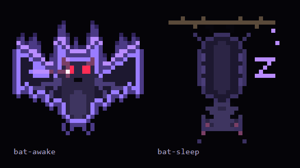

# my-herdr-app-threme

Themes for [herdr-app](https://herdr.dev). Separate from
[my-herdr-app](https://github.com/SeniolisFrame/my-herdr-app) (the Files and Changes
panels): a theme works with any layout.

## kage (影, shadow)

A near-black theme: the background, sidebars and cards are black with a trace of violet;
violet only marks what is picked, the borders and the accent; crimson for the main buttons,
a red cursor. Every text color keeps at least 4.5:1 contrast on the backgrounds it sits on.

## Bat cards (mods/kage-agents)

A copy of herdr's Agents list where each agent is a card with an 8-bit bat: wings spread, red
eyes, one glowing with a flare, and a violet aura while the agent works or needs you; hanging
upside down from a branch, wings wrapped round, with a "z" while it idles. It also paints the
space tiles in kage hues (violet, crimson, indigo, plum, dusk, wine) in place of the stock
teal/orange/blue.



`python avatars/draw.py avatars/avatars.json` draws the two 32x32 pixel grids, `node avatars/build.mjs`
turns them into the SVGs (shown at 64px, 2x).

## Install

Windows: `.\install.ps1` (with herdr-app running). It copies the theme and the mod, switches to kage, and points
your current layout's Agents block at `kage-agents`. Herdr's own layouts (main, terminals,
win98) are read-only: clone one first (`herdr-app do layout.clone`), then run it again.

macOS / Linux:

```sh
APP="${HERDR_APP_HOME:-$HOME/.config/herdr-app}"
mkdir -p "$APP/themes" "$APP/mods/kage-agents"
cp themes/*.json "$APP/themes/" && cp mods/kage-agents/* avatars/bat-*.svg "$APP/mods/kage-agents/"
herdr-app do app.theme --name kage
```

then set `"mod": "agents"` to `"kage-agents"` in your layout (`$APP/layouts/<name>.json`).

## Uninstall

Windows: `.\uninstall.ps1` with herdr-app running puts herdr's Agents list back in your
layouts, switches to graphite and removes the kage theme and mod. Herdr keeps the space tile
colors in memory, so to reset them close herdr-app and run `.\uninstall.ps1` once more.

Elsewhere: `herdr-app do app.theme --name graphite`, set `"mod": "kage-agents"` back to
`"agents"` in your layout, delete `$APP/mods/kage-agents`; with herdr closed, delete
`space.colors` from `$APP/shared.json`.
