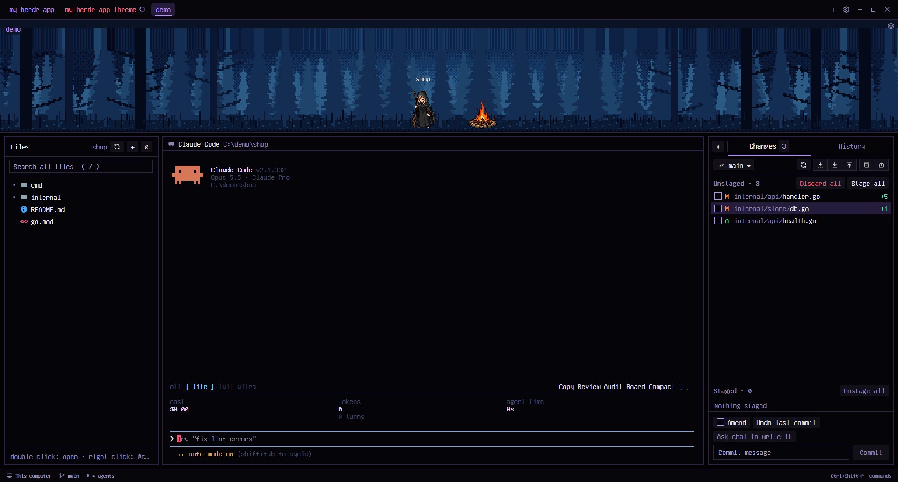
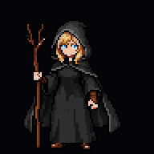
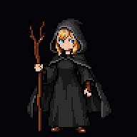

# my-herdr-app-threme

A layout and themes for [herdr-app](https://herdr.dev): a git client around your chat pane (Files on the
left, Changes on the right, every agent as a witch on a forest board at the top), all in 8-bit pixel style.
The Files and Changes panels were the separate [my-herdr-app](https://github.com/SeniolisFrame/my-herdr-app)
repo; they live here now (`mods/my-files`, `mods/my-changes`, `shared/`, `layouts/my-herdr.json`). How to use
them: [docs/panels.md](docs/panels.md). Had my-herdr-app? Run its `uninstall.ps1` first, then install this.



## kage (影, shadow)

A near-black theme: the background, sidebars and cards are black with a trace of violet;
violet only marks what is picked, the borders and the accent; crimson for the main buttons,
a red cursor. Every text color keeps at least 4.5:1 contrast on the backgrounds it sits on.

## More colors

Same layout, other colors: `.\install.ps1 -Theme <name>`, back with `.\install.ps1`. The theme files are `kage-<name>.json`, so they cannot clash with one of your own.

| name | looks |
|---|---|
| midnight | navy with gold buttons |
| sakura | black-plum with pink |
| forest | deep green with emerald, amber buttons |
| ember | warm brown-black with orange |
| ocean | deep teal with cyan, amber buttons |

Text colors keep at least 4.5:1 contrast on the backgrounds.

## Witch cards (mods/kage-agents)

A copy of herdr's Agents list where each agent is a card with a pixel-art witch (Pixellab): casting a spell, facing you,
while the agent works or needs you; dozing while it idles. Two witches, picked under Avatar in the sort menu: the
black witch in a hooded cloak with a branch staff (the default; dozes on her feet) and the blue witch with a crystal
staff (dozes on the ground). Both have 7 moves (cast, staff strike, fireball, magic circle, lightning, hand spell, staff
twirl; violet magic for the black witch, icy blue for the blue one), picked under Move in the same menu; Random, the
default, draws a new one for each agent whenever its state changes. Right-click a card to give that agent its own witch and move ("As all" goes back). Whatever the move, a DONE agent's witch cheers (hand up, a jump) and a NEEDS YOU one clasps her hands and pleads. Install turns the layout's top board into the open space's forest camp (a fixed 240px band, a camp of its own for each space): a campfire with that space's witches round it, asleep while their agent idles, casting while it works, with a speech bubble over a working Claude Code's witch chanting a spell for the step it's on (its newest `●` line, read every 3s): Perspicio! reading, Transmuto! changing a file, Ignis! running a command, Inquiro! searching, Veni, familiaris! a helper agent, another spell for its own words. That layout's sidebar (the Spaces list, Settings) is hidden: the top bar lists the spaces and has a Settings button. Uninstall gives the board and sidebar back. Each card is named
after its terminal's folder, like the tabs. `programs.json` draws the Claude icon in violet instead of orange (install writes
it only if you have none). It also paints the
space tiles in kage hues (violet, crimson, indigo, plum, dusk, wine) in place of the stock
teal/orange/blue.

| | black | blue |
|---|---|---|
| cast |  |  |
| strike |  |  |
| fireball |  |  |
| circle |  |  |
| lightning |  |  |
| hand |  |  |
| twirl |  |  |
| done |  |  |
| plead |  |  |
| sleep |  |  |

`python avatars/witch_attack.py` fits the Pixellab frames in `avatars/pixellab/` into the 96px card art;
`python avatars/make_gifs.py` then remakes the GIFs above.

## 8-bit spaces (mods/kage-spaces)

A copy of herdr's Spaces list in a pixel font (with Thai) at its native 16px: no letter tiles, each
space's name in its own color (lightened to read on black, at least 5.9:1), a colored bar on
the open one, no repo, branch or ahead/behind counts. Every kage mod uses [GNU Unifont](https://unifoundry.com/unifont/), SIL OFL 1.1
(`mods/kage-spaces/fonts/LICENSE-Unifont.txt`). The file in that folder is trimmed to Latin, Thai,
punctuation, arrows and box drawing (35KB); herdr loads fonts from a mod's `fonts/` folder at start.
The install sets the layout's `font` and `ui_font` to Unifont too, where it has none of its own (a theme file can't carry fonts in herdr, a layout can), so the terminal and other mods (Files and Changes) use it; uninstall.ps1 takes them off again.

## 8-bit tab bar (mods/kage-tabs)

Herdr's tab bar in the same pixel font: each tab named after its terminal's folder (a name you
gave a tab stays), no program icons, the open tab in the open space's name color with a line
under it. Where the sidebar is hidden (the witch board's layout) it lists the spaces instead: each
in its own color, a spinner or dot for its most urgent agent; click to switch, drag to reorder,
double-click to rename, right-click for the space menu, and an agent is reached by its witch on
the board. Show the sidebar again and the tabs come back. A Settings button sits by the window buttons.

## 8-bit pane frames (mods/kage-pane)

Each terminal pane (PowerShell, Claude Code, ...) gets square corners and a 2px border that stays
the same when it has the keyboard (the other panes fade instead), and a header in the same pixel font: program, title, folder,
the agent's status, and split/zoom/close buttons on hover. Files and Changes square their buttons and boxes to
match, and History's branch lines bend and its commit dots round in 2px pixels (a layout with rounded frames keeps
them rounded).

## Install

Windows: `.\install.ps1` (with herdr-app running; git on your PATH for the panels). It copies the theme, the
kage mods, Files/Changes/board (each checked with `herdr-app check`) and the my-herdr layout, points that
layout at the kage mods with square 2px pane frames, and switches to kage and my-herdr. The layout is copied
fresh each time: edits you made to `my-herdr.json` go. Run it again after every change or pull.
`.\kage-layout.test.ps1` checks the layout step on a copy of herdr's main layout, `node saying.test.mjs` the
board's speech bubble spells, `node shared/size.test.mjs` the panels' text sizes.
It also writes `my-herdr-text.json` (16px text, 22px rows) so Files and Changes
match the Unifont; restart herdr-app to apply it. An existing file of yours is left alone, and
`uninstall.ps1` removes it only if it is still ours.

macOS / Linux:

```sh
APP="${HERDR_APP_HOME:-$HOME/.config/herdr-app}"
mkdir -p "$APP/themes" "$APP/mods/kage-agents"
cp themes/*.json "$APP/themes/" && cp mods/kage-agents/* avatars/witch-*.png "$APP/mods/kage-agents/"
cp -r mods/kage-spaces mods/kage-tabs mods/kage-pane "$APP/mods/"
for m in my-files my-changes my-board; do
  mkdir -p "$APP/mods/$m" && cp -r shared/*.js mods/$m/* "$APP/mods/$m/" && rm -f "$APP/mods/$m/"*.test.mjs
  herdr-app check "$APP/mods/$m"     # must say: check passed
done
cp layouts/my-herdr.json "$APP/layouts/"
herdr-app do app.theme --name kage
herdr-app do layout.switch --name my-herdr
```

then, in `$APP/layouts/my-herdr.json` (what `install.ps1` does with `kage-layout.ps1`): `"mod": "my-board"` to
`"mod": "kage-agents", "props": { "board": true }` for the forest camp (and `"hidden": true` on the `sidebar` beside it),
`"spaces"` to `"kage-spaces"` and `"tabs"` to `"kage-tabs"`, `"font"` and `"ui_font"` `"Unifont"` at the top; for the pane frames,
`"pane"` to `"kage-pane"`, the pane frame's `radius` to 0 and its border and focus `width` to 2, the focus `color` to `"border"`.

## Uninstall

Windows: `.\uninstall.ps1` with herdr-app running switches to herdr's main layout and graphite, removes the
my-herdr layout, Files/Changes/board and the kage theme and mods, and puts herdr's Agents and Spaces lists,
tab bar and pane frames (rounded 10, 1px) back in any other layout an older install pointed at kage. Herdr keeps the space tile
colors in memory, so to reset them close herdr-app and run `.\uninstall.ps1` once more.

Elsewhere: `herdr-app do app.theme --name graphite`, set `"kage-agents"`/`"kage-spaces"`/`"kage-tabs"`/`"kage-pane"`
back to `"agents"`/`"spaces"`/`"tabs"`/`"pane"` in your layout (pane frame `radius` 10, widths 1), delete the `$APP/mods/kage-*` folders; with herdr closed, delete
`space.colors` from `$APP/shared.json`.
