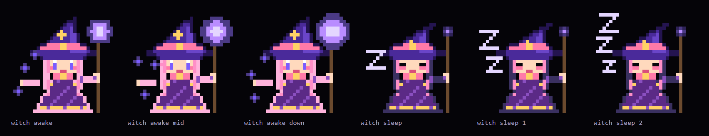

# my-herdr-app-threme

Themes for [herdr-app](https://herdr.dev). Separate from
[my-herdr-app](https://github.com/SeniolisFrame/my-herdr-app) (the Files and Changes
panels): a theme works with any layout.

## kage (影, shadow)

A near-black theme: the background, sidebars and cards are black with a trace of violet;
violet only marks what is picked, the borders and the accent; crimson for the main buttons,
a red cursor. Every text color keeps at least 4.5:1 contrast on the backgrounds it sits on.

## More colors

Same layout, other colors: `.\install.ps1 -Theme <name>`, back with `.\install.ps1`. The theme files are `kage-<name>.json`, so they cannot clash with one of your own.

| name | looks |
|---|---|
| midnight | navy with gold buttons |
| sakura | black-plum with pink |
| forest | deep green with emerald, amber buttons |
| ember | warm brown-black with orange |
| ocean | deep teal with cyan, amber buttons |

Text colors keep at least 4.5:1 contrast on the backgrounds.

## Dungeon cards and tab bar (mods/kage-agents, mods/kage-tabs)

A copy of herdr's Agents list where each agent is a card with a 32x32 pixel class: swordsman, rogue, priest,
reaper or witch. Each agent gets one at random (stable: the same agent keeps it); click the avatar on its card to
pick another, or Random. It dozes with z's while the agent idles and swings its weapon while it works. Each card is
named after its terminal's folder, like the tabs. `programs.json` draws the Claude icon in violet instead of orange
(install writes it only if you have none). It also paints the space tiles in kage hues (violet, crimson, indigo,
plum, dusk, wine) in place of the stock teal/orange/blue.



The tab bar is a dungeon (128px tall, brick wall and torches behind the tabs): every working agent stands at the
right as its class and attacks a dragon boss; with nobody working the dragon sleeps. The Agents list's top-right
button (the sort one) has a Dungeon switch that puts the plain 42px tab bar back. Herdr's Settings has no place
for mods, hence the menu.

Art: `python avatars/witch.py avatars/witch.json`, `python avatars/classes.py avatars` (the four other classes,
one json each) and `python avatars/dragon.py avatars/dragon.json` draw the pixel grids, `node avatars/build.mjs`
turns them into the SVGs (32x32 shown at 64px, the 56x56 dragon at 112px, both 2x).

## 8-bit spaces (mods/kage-spaces)

A copy of herdr's Spaces list in a pixel font (with Thai) at its native 16px: no letter tiles, each
space's name in its own color (lightened to read on black, at least 5.9:1), a colored bar on
the open one, no repo, branch or ahead/behind counts. Every kage mod uses [GNU Unifont](https://unifoundry.com/unifont/), SIL OFL 1.1
(`mods/kage-spaces/fonts/LICENSE-Unifont.txt`). The file in that folder is trimmed to Latin, Thai,
punctuation, arrows and box drawing (35KB); herdr loads fonts from a mod's `fonts/` folder at start.
To use it in the terminal too, set `"font": "Unifont"` (and `"ui_font"` for other mods) in herdr-app's `settings.json`.

## 8-bit tab bar (mods/kage-tabs)

Herdr's tab bar in the same pixel font: each tab named after its terminal's folder (a name you
gave a tab stays), no program icons, the open tab in the open space's name color with a line
under it.

## 8-bit pane frames (mods/kage-pane)

Each terminal pane (PowerShell, Claude Code, ...) gets square corners and a 2px border, violet
while it has the keyboard, and a header in the same pixel font: program, title, folder,
the agent's status, and split/zoom/close buttons on hover.

## Install

Windows: `.\install.ps1` (with herdr-app running). It copies the theme and the mod, switches to kage, and points
your current layout at the kage mods, with square 2px pane frames. Herdr's own layouts (main, terminals,
win98) are read-only: clone one first (`herdr-app do layout.clone`), then run it again.
It also leaves `kage-layout.ps1` in herdr-app's `after-layout` folder: an installer that
rewrites a layout (my-herdr-app's does) runs it afterwards, so kage stays without a second install. `.\kage-layout.test.ps1`
checks it on a copy of herdr's main layout.
It also writes `my-herdr-text.json` (16px text, 22px rows) so my-herdr-app's Files and Changes
match the Unifont; restart herdr-app to apply it. An existing file of yours is left alone, and
`uninstall.ps1` removes it only if it is still ours.

macOS / Linux:

```sh
APP="${HERDR_APP_HOME:-$HOME/.config/herdr-app}"
mkdir -p "$APP/themes" "$APP/mods/kage-agents"
cp themes/*.json "$APP/themes/" && cp mods/kage-agents/* avatars/*.svg "$APP/mods/kage-agents/"
cp -r mods/kage-spaces mods/kage-tabs mods/kage-pane "$APP/mods/"
cp mods/kage-agents/classes.js "$APP/mods/kage-tabs/"
herdr-app do app.theme --name kage
```

then set `"mod": "agents"` to `"kage-agents"` `"spaces"` to `"kage-spaces"` and `"tabs"` to `"kage-tabs"` in your layout (`$APP/layouts/<name>.json`); for the pane frames,
`"pane"` to `"kage-pane"`, the pane frame's `radius` to 0 and its border and focus `width` to 2.

## Uninstall

Windows: `.\uninstall.ps1` with herdr-app running puts herdr's Agents and Spaces lists,
tab bar and pane frames (rounded 10, 1px) back in your layouts, switches to graphite and removes the kage theme, mods and its `after-layout` script. Herdr keeps the space tile
colors in memory, so to reset them close herdr-app and run `.\uninstall.ps1` once more.

Elsewhere: `herdr-app do app.theme --name graphite`, set `"kage-agents"`/`"kage-spaces"`/`"kage-tabs"`/`"kage-pane"`
back to `"agents"`/`"spaces"`/`"tabs"`/`"pane"` in your layout (pane frame `radius` 10, widths 1), delete the `$APP/mods/kage-*` folders; with herdr closed, delete
`space.colors` from `$APP/shared.json`.
