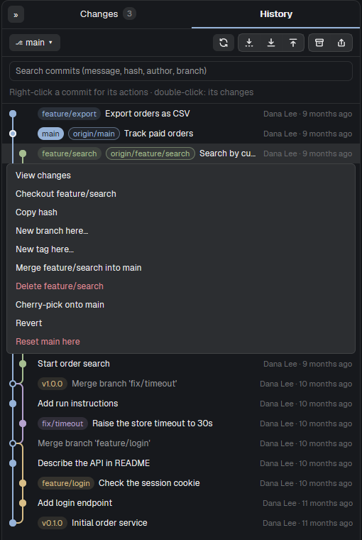

# Files, Changes and the board (mods/my-files, mods/my-changes, mods/my-board)

How to use the panels the my-herdr layout puts around your terminal. Install: see the [README](../README.md#install).

## Use

### Files (left)

- Click a folder to open it; double-click a file (or a search result) to edit it. An open file
  takes the whole window (the band on top, the chat and Changes hidden), the tree on its left:
  double-click another file there to switch. A folder opened once (and the
  folders inside the one you open) shows at once next time. `ctrl+s` saves, `←` or `esc` closes it (it
  asks first when there are unsaved edits) and brings the panels back.
  Files keep their line endings (CRLF stays CRLF). When the open file changes on disk
  (a discard in Changes, the chat editing it), it shows the new text, unless you
  have unsaved edits: Save then refuses, so nothing is overwritten. Files over 400 KB and files on
  other machines open read-only.
- `ctrl+f` finds in the file (the selected words go in the box; no file open: Search all
  files). Beside the box, `2/5` says which match of how many; **Enter** / **↓** goes to the
  next, **Shift+Enter** / **↑** to the one before, round and round. While you search, the file
  shows every match in light yellow and the current one in solid yellow, starting a few
  lines above it (plain text: the editor itself can colour only its selection). **Esc**, or
  a click on a line, goes back to the editor on that match. `ctrl+h` (or **Replace**) adds a replace box:
  **Next** replaces the found text under the cursor and finds the next one,
  **All** replaces every one in the file (then Save).
- Tab-indented files (Go) show their tabs as 4 spaces (the editor draws a tab as
  nothing) and are saved with tabs again.
- A `.csv` / `.tsv` file opens as a table (first row as the header). **Find in file**
  keeps the rows that contain the text; **Separator** is guessed (`,` `;` tab `|`),
  type another one (`tab` for a tab) to split it again. **Table** switches to its text
  to edit.
- **Search all files** (`/`): every text file, tracked or not; click a hit to open
  the file at that line.
- **Replace across files**: after a search, type the new text under it and
  **Replace all**, or **Replace** on one hit. It replaces the search text (any
  case) on the matched lines only, and skips a file that changed since the search
  or is over 400 KB.
- **Right-click** a file or folder: **@ chat**, **New file**, **New folder**,
  **Rename**, **Delete** (click twice). **+** in the header does New file / New
  folder in the top folder. On this computer only.
- **Blame**: before each run of lines from one commit, a row says who, how long ago and
  the commit's message; the code keeps the full width. Click it (or a line) to see that
  commit's change.
- **History**: the file's commits; click one to see its change.
- Select code in the open file and **right-click → Send to chat**: it types the
  file and lines (`src/a.go:12-18`) and the code in a code block into the chat.
- **@ chat** types `@path ` into the chat (the agent in this tab, else the focused
  terminal) without Enter. It goes through the clipboard and puts your clipboard
  back. Dragging a file onto a terminal pastes its full path.
- A letter shows git status: `M` modified, `A` new, `D` deleted, `U` conflict.

### Board (top)

The top band holds what herdr keeps in its left sidebar: Spaces, Settings and Add
machine on the left, and in place of the Agents list a board: every agent in every space
as a card in four columns, Needs you, Working, Done and Idle, each with its count. A card
shows the agent's program, its space (or pane name) and tab; hover for the address, click
to go to it. The focused agent's card is outlined, and the next / previous agent keys go
column by column. Colors are the theme's status colors. Drag the line under the band to
make it taller.

### Changes (right)

- Two tabs across the top: **Changes** (with the number of changed files) and
  **History**.
- Stage, unstage and commit move the files at once; git catches up
  behind (and puts them back if it refuses: a failed commit keeps its message).
  Every file's diff is read with the list, so clicking a file shows it at once.
- Two lists: **Unstaged** and **Staged**. A file that is partly staged
  is in both. The box moves a file from one list to the other; **Stage all** /
  **Unstage all**.
- Click a file to see its diff: an unstaged file shows what isn't staged yet, a
  staged one shows what is. Right-click a changed (`+` / `-`) line for its hunk's **Stage hunk** (or
  **Unstage hunk**) and **Discard hunk**. Click `+` / `-` lines to pick them: the
  menu then says **Stage 2 lines** and stages only those. **Discard hunk** (or
  **Discard 2 lines**, click twice) throws them out of the file; what is staged
  stays, and the file keeps its line endings.
- **Open** (or `o`) opens it in Files. **Discard** throws away
  the file's changes (click twice).
- The diff shows only with Changes over the whole window: double-click a file and it fills the
  window, the lists on top, so a click or `↑` `↓` moves to the next file's diff. **← Back** (top left) or `Esc` goes back.
- Type a message and **Commit** (commits what is staged).
  - **Amend**: the next Commit rewrites the last commit; its message is filled in
    to edit, and whatever is staged goes into it too.
  - **Undo last commit** (click twice): the last commit's changes go back to
    Staged and its message back in the box. It warns when that commit is already
    pushed.
  - **Ask chat to write it**: types a request into the chat for the agent to read
    the staged diff and save a message to `.git/MY_HERDR_COMMIT_MSG`. Press Enter
    in the chat; the message shows up in the box when the agent saves it.
- **⎇ branch**: check out a local or remote branch, create one, or **Merge into
  current**. **Fetch**, **Pull**, **Push** (a new branch is pushed to `origin`),
  **Stash** (untracked files too), **Pop**.
- Conflicts (after a merge, pull, stash pop, cherry-pick or revert): the file shows
  `!` and its text with the conflict markers. Take **Ours** or **Theirs** (each
  takes that side's version of the **whole file**, not only the conflict), or edit
  it in Files and click **Mark resolved**; then Commit (an empty message uses
  git's). **Abort** undoes the whole operation.
- **History** tab: the graph of all branches: one color per line,
  curves where branches split and merge, branch labels (the current branch filled,
  remote branches outlined in the line's color, tags in yellow), a hollow dot for
  merge commits. It shows 50 commits at a time (**Show 50 more** at the bottom). It
  is read ahead when the repo first shows and kept as it is: opening it again reads
  nothing; it is read again after an action that changes it (commit, merge, checkout,
  pull, stash...) or on **Sync**. Picking a commit reads its changes ahead too.
  The search box filters the last 500 commits by message, hash, author or branch. Click a commit for its actions: **View changes**, **Checkout**,
  **Merge … into** and **Delete** for each branch on it (a branch with commits no
  other branch has asks again as **Force delete**), **Checkout commit** / **Merge**
  for a commit with no branch, **Cherry-pick onto** the current branch, **Revert**,
  **Copy hash** (or `Ctrl+C`, also in a commit's changes). **Copy message** copies its whole message. Double-click opens its changes.
  **New branch here…** asks for a name (as Files' New file does) and **Create** (or
  Enter) makes a branch at that commit and switches to it.
  **New tag here…** does the same for a lightweight tag on
  that commit. A commit with a tag offers **Push tag** (to the upstream's remote, else
  `origin`; **Push** doesn't send tags) and **Delete tag** (click twice; it deletes
  the tag here only, a pushed one stays on the remote).

  

Both panels update when files change in the folder (and after their own actions);
there is no timer. **Sync** reads everything again. Each workspace, and each tab in
it, keeps its own panels (open file, open folders, selected change): switching back
shows them at once and refreshes behind. Switching away mid-load doesn't wait for it:
the load finishes in the background and is kept for when you come back.

**«** in the Files header and **»** before the Changes tab (each on the side next to
the chat) fold that panel into a thin strip; its **»** / **«** opens it again at the width it had. Each side folds on its
own, and a folded panel keeps everything (open file, unsaved edits, lists) and keeps
refreshing. Open in Changes opens a folded Files.

Keys when the panel has focus: `↑` `↓` select, `space` stage or unstage, `o` open
in Files, `c` commit message, `l` history, `s` send `@path`, `esc` back (or to the
chat).

### Commands

Both panels take commands, so you can bind keys in `~/.config/herdr-app/keys.json`
or script them: `herdr-app do my-changes.pull`.

- Both: `fold` (fold the panel, or open it again)
- `my-files.<cmd>`: `sync`, `toggle:<folder>`, `open:<path>[:<line>]`, `save`, `close`, `find:<text>` (again: the next match), `find-box` (as ctrl+f),
  `replace-in-file:<text>|<new>`, `search:<text>`, `replace-all:<new>`, `blame`,
  `history`, `send[:<path>]`, `send-code`, `table`, `separator:<s>`, `type:<text>`, `menu:<path>` then `new-file:<name>`,
  `new-folder:<name>`, `rename:<name>` or `delete` (deletes at once:
  the menu's Delete button asks twice, the command doesn't)
- `my-changes.<cmd>`: `full` (the lists and diff over the whole window, or back), `sync`, `select:<path>` (or `select:staged:<path>` /
  `select:unstaged:<path>`), `stage`, `stage-all`, `unstage-all`, `hunk:<n>`,
  `discard-hunk:<n>` (twice), `line:<hunk>:<line>`, `discard`, `open`, `ours`, `theirs`, `commit[:<message>]`,
  `amend`, `undo` (twice), `ask`, `fetch`, `pull`, `push`, `stash`, `pop`, `abort`,
  `branches`, `checkout:<branch>`, `merge:<branch>`, `new-branch:<name>[:<hash>]`,
  `delete-branch:<name>` (twice), `history`, `log-search:<text>`, `pick:<hash>`,
  `show:<hash>`, `cherry-pick:<hash>`, `revert:<hash>`, `tag:<name>[:<hash>]` (HEAD without a hash),
  `delete-tag:<name>` (twice), `push-tag:<name>`

Example `keys.json` section:

```json
"mod:my-changes": { "ctrl-enter": "my-changes.commit", "alt-p": "my-changes.push" }
```

## Known limits

- Staging hunks and lines, saving, file actions and sending `@path` work on this
  computer only (not in a space on another machine).
- git runs without a terminal: pull and push need credentials that don't prompt in
  a terminal (Git Credential Manager, ssh-agent).
- History shows the last 500 commits; its search looks in those.
- Every git call starts a program (about 25 ms here, more on slow machines): the
  panels show what they expect first and read in the background, but an action
  still waits for its own git. Folders under your home folder are listed in-process;
  others (`C:\demo`, a space on another machine) with PowerShell or sh, which is slower.
- A file with both CRLF and LF line endings is saved with CRLF on every line.

## Code

Each panel's `main.js` holds the class (init, commands, refresh, keys, render); the
other files add its methods by job (`Object.assign(<Class>.prototype, ...)`).

| Path | What |
| --- | --- |
| `shared/common.js` | helpers both panels use (git, the chat, diff rows, lazy lists, folding a panel) and the shared elements: buttons, menu, name form, check box, click-twice button, text box |
| `mods/my-files/main.js` | Files: the class, commands, keys, drawing |
| `mods/my-files/tree.js` | listing folders (in-process under the home folder, else sh or PowerShell) and the refresh |
| `mods/my-files/editor.js` | the open file: edit, save, find, replace, blame, history |
| `mods/my-files/actions.js` | search and replace across files, @path, new / rename / delete |
| `mods/my-files/icons.js`, `icons/` | which icon a file or folder gets; the icons are [Material Icon Theme](https://github.com/material-extensions/vscode-material-icon-theme)'s (MIT) (test: `node mods/my-files/icons.test.mjs`) |
| `mods/my-files/text.js` | tab ↔ space indents, replacing text, the Send to chat snippet, CSV parsing, blame runs (test: `node mods/my-files/text.test.mjs`) |
| `mods/my-changes/main.js` | Changes: the class, commands, status refresh, the diff, keys |
| `mods/my-changes/actions.js` | stage, discard, commit, remote, stash, branches |
| `mods/my-changes/history.js` | the History graph, a commit's actions (branches, tags) and its changes |
| `mods/my-changes/view.js` | drawing: tabs, toolbar, lists, diff, branch menu, commit box |
| `mods/my-changes/status.js` | limits and the status-list helpers |
| `mods/my-changes/patch.js` | patches for staging hunks and single lines (test: `node mods/my-changes/patch.test.mjs`) |
| `mods/my-changes/graph.js` | history graph lanes (test: `node mods/my-changes/graph.test.mjs`) |
| `mods/my-board/main.js` | Board: the agent cards in the top band |
| `layouts/my-herdr.json` | herdr's `main` layout with Files left, Changes right, and Spaces with the Board in a band on top |
| `install.ps1`, `uninstall.ps1` | copy into / remove from `~/.config/herdr-app` |

A mod can't import from outside its own folder, so `install.ps1` copies
`shared/common.js` into both mods (in the repo too; git ignores those copies). Edit
`shared/common.js`, never `mods/*/common.js`, then run `install.ps1`: it checks both
mods with `herdr-app check` and stops if one fails.
